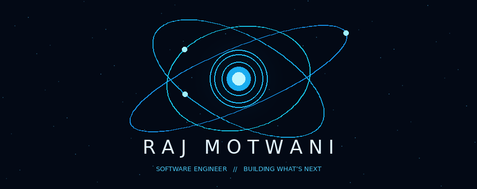
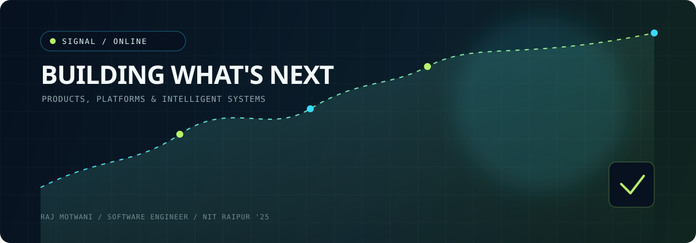

<div align="center">



<br />

<a href="https://github.com/raj3000k"></a>
<a href="https://www.linkedin.com/in/raj-motwani-978143204/"></a>
<a href="https://raj-m-portfolio.netlify.app/"></a>

</div>

<br />



## 01 / Signal

```text
SOFTWARE ENGINEER  //  PRODUCT-MINDED BUILDER  //  NIT RAIPUR '25
```

I turn ambiguous ideas into useful systems: reliable backends, intelligent data products, and tools that make complicated work feel lighter. My current orbit is **backend engineering, AI systems, developer tools, and open source**.

## 02 / Career trajectory

| Signal    | Where it led                                  |
| :-------- | :-------------------------------------------- |
| `NOW`     | **Software Engineer** at **Mercedes-Benz**    |
| `BEFORE`  | **Data Engineer Intern** at **ZS Associates** |
| `EARLIER` | **Software Engineer** at **UrbanPiper**       |

## 03 / Stack map

<table>
	<tr>
		<td><strong>LANGUAGES</strong><br />C++ · Python · JavaScript · SQL<br />Dart · Swift</td>
		<td><strong>BUILD</strong><br />React · Node.js · FastAPI<br />Flutter · MongoDB</td>
		<td><strong>SHIP</strong><br />Docker · Git · Linux<br />TensorFlow · Figma</td>
	</tr>
</table>

## 04 / Things I have shipped

<table>
	<tr>
		<td width="50%"><strong>01 / SOLAR INTELLIGENCE</strong><br />Exploring rooftop solar potential through satellite imagery.</td>
		<td width="50%"><strong>02 / CUSTOMER SIGNALS</strong><br />Extracting patterns from behavior data to support better decisions.</td>
	</tr>
	<tr>
		<td><strong>03 / NATIVE MUSIC</strong><br />A focused iOS music player built in Swift.</td>
		<td><strong>04 / HUB TESTING</strong><br />A mock aggregator supporting UrbanPiper's product testing workflows.</td>
	</tr>
</table>

## 05 / GitHub telemetry

<div align="center">


</div>

<div align="center">


</div>

<br />

<div align="center">

`keep building // keep learning // keep shipping`

</div>
